  

### Systems Architecture · Hardware Emulation · Low-Level Runtimes

*Building software that makes hardware execute what it was never designed for — Windows PE64 on Xbox Dev Mode, commercial Switch emulation on console D3D12, AAA game engines running in WebGPU, and ultra-low-latency autonomous agent runtimes.*

 

---

### ⚡ Selected Engineering Works

<table>
  <tr>
    <td width="50%" valign="top">
      <h3>🎮 <a href="https://github.com/xanstomper/Tiramisu">Tiramisu</a></h3>
      
<b>Windows PE64 Runtime for Xbox Series X|S Dev Mode</b>

      
Enables running unmodified x86_64 Windows PC games and binaries directly on Xbox Series consoles. Implements PE loader, Win32 HLE syscall translation, and DXGI/D3D12 mapping targeting UWP without Wine or POSIX emulation layers.

      
<code>C++20</code> <code>Win32 HLE</code> <code>D3D12</code> <code>PE64</code>

    </td>
    <td width="50%" valign="top">
      <h3>🕹️ <a href="https://github.com/xanstomper/nemu">Nemulator (nemu)</a></h3>
      
<b>Nintendo Switch Emulator for Xbox Dev Mode</b>

      
Commercial NCA/NSO boot engine tuned for Xbox Series S/X hardware constraints. Full Horizon OS HLE (49 SVCs / 54 services), 162 Maxwell SASS shader translations, multi-render-target, and unified memory budget architecture.

      
<code>C++20</code> <code>D3D12</code> <code>ARM64 JIT</code> <code>Horizon HLE</code>

    </td>
  </tr>
  <tr>
    <td width="50%" valign="top">
      <h3>⚡ <a href="https://github.com/xanstomper/mochi">Mochi</a></h3>
      
<b>Minimal, Autonomous Coding Agent for the Terminal</b>

      
Ultra-low-latency coding agent engine built from scratch. Directed acyclic task DAGs, multi-agent coordination, persistent HTTP daemon, and zero-runtime-dependency Rust core with an 11ms cold start and 1,494 verified tests.

      
<code>Rust</code> <code>TypeScript</code> <code>Terminal UI</code> <code>DAGs</code>

    </td>
    <td width="50%" valign="top">
      <h3>🌴 <a href="https://github.com/xanstomper/GroveTheft">GroveTheft</a></h3>
      
<b>GTA V In-Browser WebGPU / WASM Engine Port</b>

      
Self-hosted WebGPU and WebAssembly port of the RAGE engine pipeline. Zero telemetry, moddable, Brotli-optimized asset streaming running directly inside modern browsers.

      
<code>WebGPU</code> <code>WebAssembly</code> <code>C++</code> <code>RAGE</code>

    </td>
  </tr>
  <tr>
    <td width="50%" valign="top">
      <h3>🔬 <a href="https://github.com/xanstomper/coreprobe">CoreProbe</a></h3>
      
<b>iOS Forensic Workstation & Zero-Day Research Platform</b>

      
Open-source Cellebrite-class research suite: 77 verified public exploit routes, 36 CVE references, proprietary BFU (Before-First-Unlock) decryption stack, and automated DFU fuzzing harness.

      
<code>Python</code> <code>C</code> <code>iOS Forensics</code> <code>Exploit RE</code>

    </td>
    <td width="50%" valign="top">
      <h3>🏰 <a href="https://github.com/xanstomper/castle-pc-web">Castle Crashers Web</a></h3>
      
<b>PC Game Web Port & AVM1 Injection Harness</b>

      
In-browser execution engine for Castle Crashers PC dumps using self-hosted Ruffle/WASM with custom AVM1 bytecode patchers, encrypted container unpacking, and memory persistence bridges.

      
<code>JavaScript</code> <code>WASM</code> <code>AVM1</code> <code>Reverse Eng</code>

    </td>
  </tr>
  <tr>
    <td width="50%" valign="top">
      <h3>🍒 <a href="https://github.com/xanstomper/CherryBlossom">CherryBlossom</a></h3>
      
<b>Xbox 360 Stealth Server & Hypervisor Patcher</b>

      
Open-source Xbox 360 security research platform: Gold bypass, live hypervisor kernel memory patching, offline mode, and network handshake virtualization.

      
<code>C++</code> <code>PowerPC Xenon</code> <code>HV Patching</code>

    </td>
    <td width="50%" valign="top">
      <h3>🖥️ <a href="https://github.com/xanstomper/terminus">Terminus</a></h3>
      
<b>Persistent Multi-Agent Terminal Control Plane</b>

      
Universal machine-level agent control plane and persistent terminal daemon. Full PTY multiplexer, cross-agent orchestration, and remote mobile/LAN browser access.

      
<code>Python</code> <code>PTY Engine</code> <code>FastAPI</code> <code>Linux</code>

    </td>
  </tr>
</table>

---

XANSTOMPER · github.com/xanstomper

